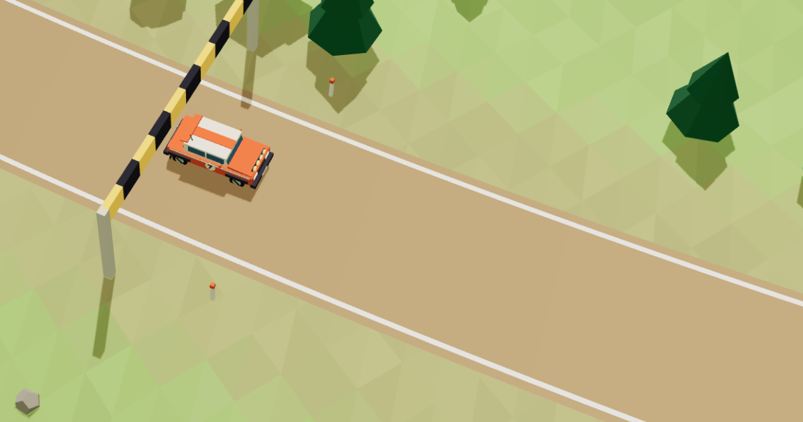

# Micro Rally

A cozy, flat-shaded low-poly rally game for the browser. Drive procedural
point-to-point stages, earn prize money, upgrade your car and buy new ones.
No accounts, no ads, no tracking: a Game ID is all you need to continue on
another device.



## What's in the game

- **Procedural stages.** Every stage is generated from your game's seed:
  a winding road through terrain, checkpoint gates and a finish line, with a
  par time, prize money for finishing and repair fees for hitting the scenery.
- **Four camera views.** Chase, cab (bonnet), interior (behind the wheel,
  with a modelled dashboard, working speedo and tacho and a steering wheel
  that turns) and isometric. Cycle with `C` or pick one in Settings.
- **Garage.** Seven upgrades (engine, turbo, tyres, suspension, brakes,
  gearbox, weight) with per-level pricing that change the physics, and a
  dealership with a second car: a low 1970s wedge coupé.
- **Saves and Game IDs.** Progress is saved on your device and online under
  an 8-character Game ID. Paste the ID on another device, or open a
  `?game=…` link, to continue. Autosave runs on start, after progress, every
  minute and when you leave.
- **HUD.** Stage timer, checkpoint count, a progress bar down the left edge
  with checkpoint ticks, money, speed and gear, plus a Game panel with stage
  facts, your driver name and Game ID.
- **Touch and desktop.** On-screen steer, handbrake, brake and gas pads on
  touch devices; keyboard on desktop. The layout adapts to phones in
  landscape, with safe-area insets.
- **Attract-mode splash.** The start screen plays a live drive through a
  freshly generated stage behind the card.
- **Three languages** (English, Spanish, Italian), switchable from the splash
  footer or Settings.
- **Accessibility.** Keyboard-only play, visible focus, labelled controls,
  and `prefers-reduced-motion` turns off camera roll, speed effects and the
  attract-mode motion.

## Controls

| Key                   | Action                                             |
| --------------------- | -------------------------------------------------- |
| `W` / `S` · `↑` / `↓` | Throttle / brake, hold to reverse                  |
| `A` / `D` · `←` / `→` | Steer                                              |
| `Space`               | Handbrake                                          |
| `Shift`               | Turbo (once fitted in the Garage)                  |
| `R`                   | Back to the last checkpoint                        |
| `C` · `V`             | Switch camera (chase / cab / interior / isometric) |
| Mouse wheel           | Zoom (chase and isometric)                         |
| `` ` ``               | Debug overlay                                      |
| `Esc`                 | Open / close the Game panel                        |

## Getting started

```sh
pnpm install
pnpm dev          # http://localhost:3000
pnpm check        # typecheck + lint + unit tests + build
pnpm test:e2e     # Playwright suite (desktop + phone landscape)
pnpm brand        # re-render icons and the Open Graph image from assets/
```

Node 22 and pnpm (see `packageManager` in `package.json`).

## How it's built

- **Next.js 16 + React 19**, TypeScript strict, Tailwind CSS 4.
- **three.js via React Three Fiber** for rendering; terrain chunks stream
  around the car and are built in workers.
- **Pure TypeScript simulation** in `src/game` (no three, no React): vehicle
  physics at a fixed 120 Hz with interpolated rendering, stage generation,
  timing, economy and the save format, all unit-tested with Vitest.
- **Zustand** stores for game, settings and HUD state; the HUD updates at
  10 Hz and the frame loop never touches React state.
- **Playwright** end-to-end tests, including a phone-landscape profile.

```
src/game         pure TS: vehicle/, stage/, economy/, save/
src/render       three.js builders: terrain chunks + workers, road, scenery
src/components   game/ (canvas, cameras, car models), hud/, splash/, privacy/
src/state        Zustand stores
src/i18n         typed dictionaries (en, es, it)
src/app          Next.js app: pages, metadata, /api/games/[id] save API
src/lib          browser-side helpers (save backends, site constants)
assets/          brand SVGs (logo, favicon, Open Graph) — source of truth
docs/            BRIEF, PLAN, ARCHITECTURE, DECISIONS, DEPLOY
```

## Deploy

Zero-config on Vercel: import the repository, add the Upstash Redis (Vercel
KV) storage integration for online saves, and deploy. Without Redis the game
still runs and saves stay on each device. Self-hosting uses a file store.
Steps, environment variables and a post-deploy smoke test are in
[docs/DEPLOY.md](docs/DEPLOY.md); see [.env.example](.env.example).

## Documentation

- [docs/BRIEF.md](docs/BRIEF.md) — design brief
- [docs/PLAN.md](docs/PLAN.md) — milestones and status
- [docs/ARCHITECTURE.md](docs/ARCHITECTURE.md) — code map and data flow
- [docs/DECISIONS.md](docs/DECISIONS.md) — technical decisions log
- [docs/DEPLOY.md](docs/DEPLOY.md) — deployment
- [CLAUDE.md](CLAUDE.md) — project rules for contributors and agents

## Privacy

The game stores only your driver name and game state, on your device and
on the server under your Game ID. No cookies, analytics or third-party
scripts. The in-app policy is at `/privacy`.

Fonts and any third-party assets are listed in [CREDITS.md](CREDITS.md).

Created by [Luis Hermosilla](https://www.luigiht.com).
