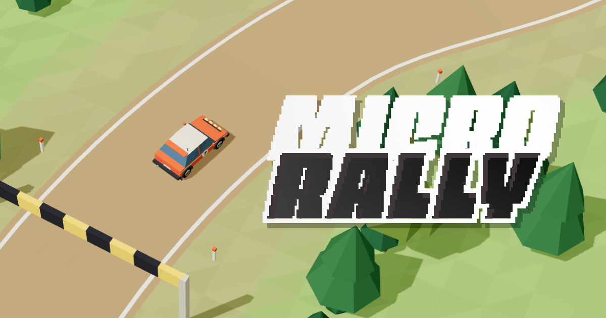

# Micro Rally

A cozy, flat-shaded low-poly rally game for the browser. Drive procedural
point-to-point stages through forests, alpine passes, hill-top villages,
along sea cliffs and over desert dunes, earn prize money, upgrade your car and buy new ones. No
accounts, no ads, no cookies: a Game ID is all you need to continue on
another device.



## What's in the game

- **Procedural stages.** Every stage is generated from your game's seed: a
  winding road through terrain, checkpoint gates in order and a finish line,
  with a par time, prize money for finishing and repair fees for hitting the
  scenery. Regions cycle Forest, Alpine, Coast (a cliff road over the sea)
  and Desert (a sand piste through dunes and oases) in ones and twos, and
  lengthen every six stages.
- **Towns.** Every third stage threads a hill village: right-angle corners
  laid as arcs, narrow old-town streets, blocked side streets closed by
  cones, terraced houses behind garden walls, kerbed pavements and lamp
  posts.
- **Four camera views.** Chase, interior (behind the wheel of each car's own
  modelled cabin), isometric and a cinematic director that cuts between
  trackside TV cameras, a helicopter, chase and camera cars. Cycle with `C`
  or pick one in Settings; `H` hides the HUD for a clean view.
- **Replay.** After the finish, watch the run back from any camera, then go
  straight on to the result panel.
- **Garage.** Seven upgrades (engine, turbo, tyres, suspension, brakes,
  gearbox, weight) with per-level pricing that change the physics at once,
  and a dealership of nine procedural cars from the starter hatch to a
  rally-raid truck.
- **Saves and Game IDs.** Progress is saved on your device and online under
  an 8-character Game ID. Paste the ID on another device, or open a
  `?game=…` link, to continue. Autosave runs on start, after progress, every
  minute and when you leave.
- **HUD.** Stage timer, checkpoint count, a progress bar down the left edge
  with checkpoint ticks, money, speed and gear, plus a Game panel with stage
  facts, a list of stages you can drive again, your driver name and Game ID.
- **Touch and desktop.** On-screen steer, handbrake, brake and gas pads on
  touch devices with a pause menu; keyboard on desktop. The layout adapts
  to phones in landscape, with safe-area insets.
- **Attract-mode splash.** The start screen plays a live drive through a
  freshly generated stage behind the card.
- **Three languages** (English, Spanish, Italian), switchable from the splash
  footer or Settings.
- **Accessibility.** Keyboard-only play, visible focus, labelled controls,
  and `prefers-reduced-motion` turns off camera roll, speed effects, the
  cinematic camera's zooms and orbits and the attract-mode motion.

## Controls

| Key                   | Action                                                   |
| --------------------- | -------------------------------------------------------- |
| `W` / `S` · `↑` / `↓` | Throttle / brake, hold to reverse                        |
| `A` / `D` · `←` / `→` | Steer                                                    |
| `Space`               | Handbrake                                                |
| `Shift`               | Turbo (once fitted in the Garage)                        |
| `R`                   | Back to the last checkpoint                              |
| `C`                   | Switch camera (chase / interior / isometric / cinematic) |
| `H`                   | Hide or show the HUD                                     |
| Mouse wheel           | Zoom (chase, isometric and cinematic)                    |
| `` ` ``               | Debug overlay                                            |
| `Esc`                 | Close any panel, leave a replay, or open the Game panel  |

## Getting started

```sh
pnpm install
pnpm dev          # http://localhost:3000
pnpm check        # typecheck + lint + unit tests + build
pnpm test:e2e     # Playwright suite (desktop + phone landscape)
pnpm brand        # re-render icons (192/512/Apple) and the Open Graph image from assets/
```

Node 22 and pnpm (see `packageManager` in `package.json`). Development URL
flags: `/?track=test` opens the flat proving ground; `/?spawn=<metres>` or
`/?spawn=town` starts a stage part-way along, for inspecting a stretch.

## How it's built

- **Next.js 16 + React 19**, TypeScript strict, Tailwind CSS 4.
- **three.js via React Three Fiber** for rendering; terrain chunks stream
  around the car and are built in workers; cars are lofted low-poly hulls.
- **Pure TypeScript simulation** in `src/game` (no three, no React): vehicle
  physics at a fixed 120 Hz with interpolated rendering, stage and town
  generation, timing, economy, the replay recording and the save format,
  all unit-tested with Vitest.
- **Zustand** stores for game, settings, UI and HUD state; the HUD updates at
  10 Hz and the frame loop never touches React state.
- **Playwright** end-to-end tests, including a phone-landscape profile.

```
src/game         pure TS: vehicle/, stage/ (roads, towns), economy/, save/, replay/
src/render       three.js builders: terrain chunks + workers, road, towns, scenery, car hulls, tyre marks
src/components   game/ (canvas, cameras, car bodies and interiors), hud/, splash/, privacy/
src/state        Zustand stores
src/i18n         typed dictionaries (en, es, it)
src/app          Next.js app: pages, metadata, /api/games/[id] save API
src/lib          browser-side helpers (save backends, camera modes, site constants)
assets/          brand SVGs (logo, favicon, Open Graph) — source of truth
docs/            BRIEF, PLAN, ARCHITECTURE, DECISIONS, DEPLOY, GAMEPLAY, CONTENT, TESTING
```

## Deploy

Zero-config on Vercel: import the repository, connect a Supabase project
(run the migration in `supabase/migrations`) for online saves, and deploy.
Without Supabase the game still runs and saves stay on each device.
Self-hosting uses a file store. Steps, environment variables and a
post-deploy smoke test are in [docs/DEPLOY.md](docs/DEPLOY.md); see
[.env.example](.env.example).

## Documentation

- [CHANGELOG.md](CHANGELOG.md) — what changed, by day
- [docs/GAMEPLAY.md](docs/GAMEPLAY.md) — how the game plays today, with the numbers
- [docs/CONTENT.md](docs/CONTENT.md) — stages, towns, regions, cars and surfaces
- [docs/ARCHITECTURE.md](docs/ARCHITECTURE.md) — code map and data flow
- [docs/TESTING.md](docs/TESTING.md) — checks, test suites and how to screenshot a change
- [docs/DECISIONS.md](docs/DECISIONS.md) — numbered log of technical decisions
- [docs/PLAN.md](docs/PLAN.md) — milestones and status
- [docs/BRIEF.md](docs/BRIEF.md) — the original design brief
- [docs/DEPLOY.md](docs/DEPLOY.md) — deployment
- [CLAUDE.md](CLAUDE.md) and [AGENTS.md](AGENTS.md) — project rules for contributors and agents

## Privacy

The game stores only your driver name and game state, on your device and on
the server under your Game ID. It sets no cookies and loads no third-party
scripts or fonts. The deployment on Vercel counts page views with Vercel Web
Analytics, which is cookie-free and keeps no personal data; a self-hosted
build sends nothing. The in-app policy is at `/privacy`.

Fonts and any third-party assets are listed in [CREDITS.md](CREDITS.md).

## Licence

All rights reserved. The repository is public so the game and its code can be
seen, but no licence is granted to use, copy, modify or redistribute any of
it; see [LICENSE](LICENSE). The Press Start 2P font keeps its own open
licence.

Created by [Luis Hermosilla](https://www.luigiht.com).
