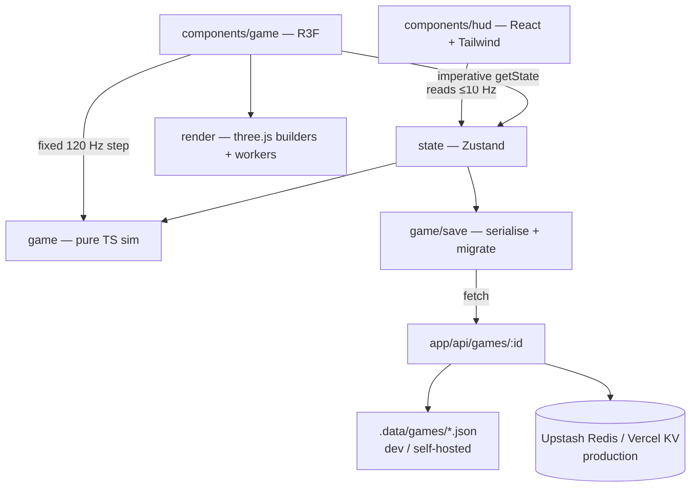
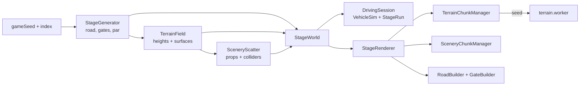
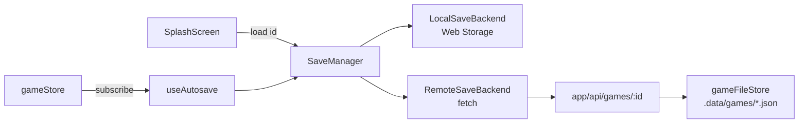

# Architecture

## Layers

- **`src/game`, `src/lib`** — pure TypeScript. No `three`, no React. Vehicle
  physics, stage generation (splines, checkpoints, timing), economy, save
  format. Everything here is deterministic and unit-tested.
- **`src/render`** — three.js geometry/material builders, terrain chunk
  workers, particles, skid marks. Each builder returns disposables.
- **`src/components/game`** — R3F `<Canvas>`, scene graph, camera rigs. The
  frame loop accumulates time and steps the sim at a fixed 120 Hz, then
  interpolates transforms for rendering.
- **`src/components/hud`** — menus, HUD, garage, settings. Subscribes to
  throttled store slices; never re-renders per frame.
- **`src/state`** — Zustand stores (game/meta state, settings).
- **`src/i18n`** — typed dictionaries; `en` is the source of truth for keys.

## Frame loop (from milestone 2)

1. `useFrame` reads input refs.
2. Accumulator steps `VehicleSim` at `1/120 s`, keeping previous + current
   state.
3. Render transforms = lerp/slerp(previous, current, alpha) into reused
   temp objects.
4. Active `CameraRig.update(dt)` positions the camera.
5. HUD snapshot is pushed to the store at ≤ 10 Hz.

## Stage pipeline (milestone 3)

- `DrivingSession` (components/game) is a plain class held in a ref. It owns
  the sim, the stepper, input, the camera rig and the `StageRun`, and
  publishes telemetry/HUD snapshots to Zustand at 10 Hz.
- `StageRenderer` owns every three.js object for a stage and disposes them
  together; chunk managers stream around the car via `ChunkStreamer`.

## Save pipeline (milestone 6)

- `src/game/save` is pure: `GameId` (Crockford base32, normalize/format) and
  `SaveFile` (versioned schema, defensive `parseSaveFile`, `newestSave`).
- `SaveManager` (`src/lib/save`) writes locally first, then online; a failed
  upload flips `saveStore.status` to `offline` and the next save retries.
  Loads return the newest of the two copies.
- `useAutosave` reads the store imperatively and saves on start, 2.5 s after
  progress changes, every minute, on `visibilitychange`/`pagehide` (with
  `keepalive`) and on unmount.
- The route validates every body with `parseSaveFile`; IDs are checked before
  any key or filesystem path is built. `gameStore.ts` picks the backend from
  the environment: Redis over the Upstash REST API when `KV_REST_API_*` (or
  `UPSTASH_REDIS_REST_*`) is set, the file store otherwise, and none on Vercel
  without Redis (the API answers 503 and saves stay on the device). See
  `docs/DEPLOY.md`.
