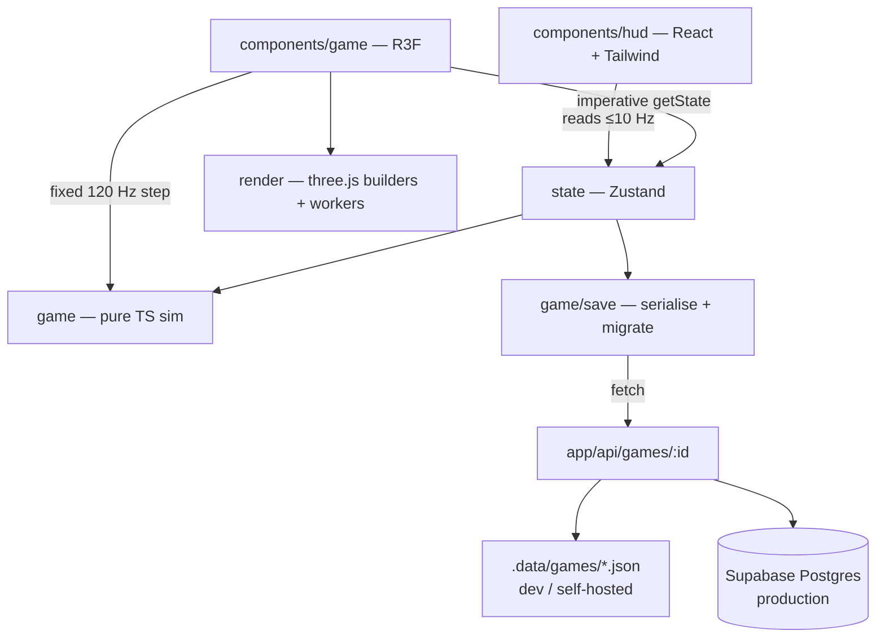
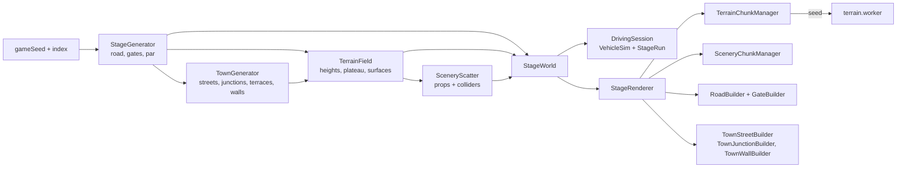
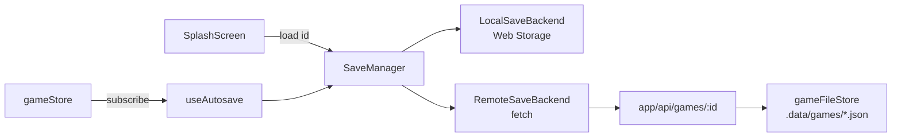

# Architecture

## Layers

- **`src/game`, `src/lib`** — pure TypeScript. No `three`, no React. Vehicle
  physics, stage generation (splines, checkpoints, timing), economy, save
  format. Everything here is deterministic and unit-tested.
- **`src/render`** — three.js geometry/material builders, terrain chunk
  workers, particles, skid marks. Each builder returns disposables.
- **Car models** — `components/game/CarModel` builds every car from
  primitives (`bodies/*Body.tsx`) around shared wheels, interior and an
  imperative handle; the GLBs in `assets/` are measurement references only.
- **`src/components/game`** — R3F `<Canvas>`, scene graph, camera rigs. The
  frame loop accumulates time and steps the sim at a fixed 120 Hz, then
  interpolates transforms for rendering.
- **`src/components/hud`** — menus, HUD, garage, settings. Subscribes to
  throttled store slices; never re-renders per frame.
- **`src/state`** — Zustand stores (game/meta state, settings).
- **`src/i18n`** — typed dictionaries; `en` is the source of truth for keys.

## Frame loop (from milestone 2)

1. `useFrame` reads input refs.
2. Accumulator steps `VehicleSim` at `1/120 s`, keeping previous + current
   state.
3. Render transforms = lerp/slerp(previous, current, alpha) into reused
   temp objects.
4. Active `CameraRig.update(dt)` positions the camera.
   `wheelContacts` (pure) turns the pose + slip into four contact patches and
   `SkidMarks` (render) appends quads to its ring buffer when a tyre scrubs.
5. HUD snapshot is pushed to the store at ≤ 10 Hz.

## Stage pipeline (milestone 3)

- Towns (`game/stage/Town.ts`, `TownPlan.ts`, `TownGenerator.ts`): every
  third stage, the last of each region's run, carries one; `planTown` draws
  the route through a hill town as legs (straights with 60°–105° corners laid
  as 12 m arcs, tight curves, a narrow old-town section), validated against
  the self-approach rule; the centreline builder (`Centreline.ts`) steers
  onto the stage axis, lays them and resumes on the arrival heading, and
  `layoutTown` derives streets, junctions (`TownJunctions.ts`: arms, wedges,
  side-street cuts), blocked side streets with cone rows and end buildings
  (`TownSideStreets.ts`), direction boards, and then the village itself:
  facade polylines a pavement beyond the route's real edge and along every
  side street, walked by `TownTerraces.row` to stand houses a party wall
  apart with garden walls over every gap, L-walls round each junction wedge
  with a tree and bushes planted behind them, and the footprint.
  `TownKerbs.ts` traces each junction's kerbs exactly (kerb returns between
  side streets and the route's curved edge, with normals) and the stretches
  where the ribbon hands its verge and line over. `TerrainField` tames the hills inside the
  footprint (streets still climb and dip), cuts side streets into the slope,
  levels a terrace under each building at its door and treats every town
  street as paved; `SceneryScatter` keeps wild scenery only off streets,
  buildings and walls (`townBlocks`) and emits the town's props; buildings,
  walls and barriers collide as oriented boxes (`vehicle/Collisions.ts`).
  Render side: `RoadBuilder` paves the route through town at its per-sample
  width with kerbed pavements cut exactly at each junction opening,
  `TownJunctionBuilder` lays the pavement band and edge line as offset strips
  along the kerb outlines and fills the mouths with tarmac cut from the
  junction's distance field (`Isobands.ts`), `TownStreetBuilder` lays the
  side-street plates, lines and pavements beyond each cut, `TownWallBuilder`
  merges the garden walls, and `SceneryChunkManager` instances the building,
  flower-box and street-furniture kits (`render/scenery/BuildingGeometry.ts`,
  `CivicGeometry.ts`, `PlanterGeometry.ts`, `StreetFurnitureGeometry.ts`).

- `DrivingSession` (components/game) is a plain class held in a ref. It owns
  the sim, the stepper, input, the camera rig and the `StageRun`, and
  publishes telemetry/HUD snapshots to Zustand at 10 Hz. It also records the
  run into a `ReplayTrack` (`game/replay/`, pure TS: one sample per fixed
  step, blended on playback) and, when the HUD asks after the finish, plays it
  back in place of the sim: the car follows the recording, input is ignored,
  the camera rigs keep working and Esc or the HUD's button leaves it.
- Camera rigs (`components/game/cameras/`): `ChaseCameraRig`,
  `FirstPersonCameraRig` (interior), `IsometricCameraRig` and
  `CinematicCameraRig`, built by `createCameraRig` and swapped by
  `DrivingSession` when the setting changes. The cinematic rig's director,
  `CinematicShots.ts`, is pure TS: it draws trackside, helicopter,
  chase-car, camera-car and reverse tracking shots, stands trackside cameras
  beside the stage road ahead (lifted clear of the terrain between them and
  the car) and cuts under the 180° and 30° rules; the rig pans, follows and
  zooms each shot with frame-rate-independent damping and hard-cuts between
  them.
- `StageRenderer` owns every three.js object for a stage and disposes them
  together; chunk managers stream around the car via `ChunkStreamer`.
  `CarInterior` (components/game) assembles the first-person cabin from
  `interior/interiorSpecs.ts` (per-car envelope, kit and palette) using
  `interior/InteriorParts.tsx` and `interior/InteriorDash.tsx`; the pose
  carries gear and turbo state so levers and lamps animate per frame.
  `SceneryScatter` also dots houses (kind `house`, three-circle colliders)
  well back from the road; `HouseGeometry` builds the two vertex-coloured
  instanced parts. `GateBuilder` draws start/finish gantries and, at
  checkpoints, a pair of rally time-control boards.
- `stageBrief` draws a stage's name, surface, length and par from the same
  RNG stream `generateStage` uses, without building the road; `StageHistory`
  derives the frontier (first unfinished stage) from `records` and picks the
  window the Game panel's `StageList` shows. `gameStore.driveStage` re-drives
  any stage up to the frontier.

## Save pipeline (milestone 6)

- `src/game/save` is pure: `GameId` (Crockford base32, normalize/format) and
  `SaveFile` (versioned schema, defensive `parseSaveFile`, `newestSave`).
- `SaveManager` (`src/lib/save`) writes locally first, then online; a failed
  upload flips `saveStore.status` to `offline` and the next save retries.
  Loads return the newest of the two copies.
- `useAutosave` reads the store imperatively and saves on start, 2.5 s after
  progress changes, every minute, on `visibilitychange`/`pagehide` (with
  `keepalive`) and on unmount.
- The route validates every body with `parseSaveFile`; IDs are checked before
  any key or filesystem path is built. `gameStore.ts` picks the backend from
  the environment: Supabase Postgres over its REST API when `SUPABASE_URL`
  and `SUPABASE_SERVICE_ROLE_KEY` are set, the file store otherwise, and none
  on Vercel without Supabase (the API answers 503 and saves stay on the
  device). See `docs/DEPLOY.md`.
