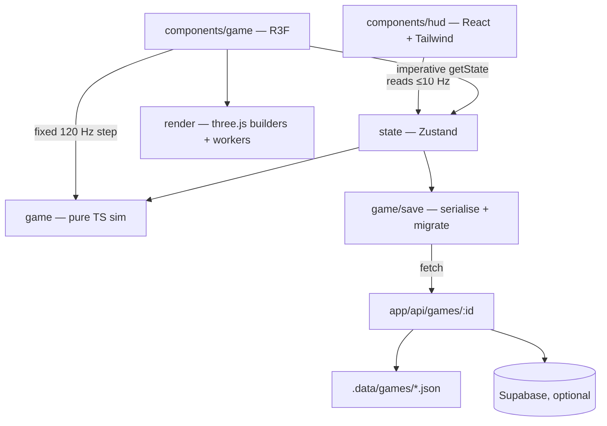

# Architecture

## Layers

- **`src/game`, `src/lib`** — pure TypeScript. No `three`, no React. Vehicle
  physics, stage generation (splines, checkpoints, timing), economy, save
  format. Everything here is deterministic and unit-tested.
- **`src/render`** — three.js geometry/material builders, terrain chunk
  workers, particles, skid marks. Each builder returns disposables.
- **`src/components/game`** — R3F `<Canvas>`, scene graph, camera rigs. The
  frame loop accumulates time and steps the sim at a fixed 120 Hz, then
  interpolates transforms for rendering.
- **`src/components/hud`** — menus, HUD, garage, settings. Subscribes to
  throttled store slices; never re-renders per frame.
- **`src/state`** — Zustand stores (game/meta state, settings).
- **`src/i18n`** — typed dictionaries; `en` is the source of truth for keys.

## Frame loop (from milestone 2)

1. `useFrame` reads input refs.
2. Accumulator steps `VehicleSim` at `1/120 s`, keeping previous + current
   state.
3. Render transforms = lerp/slerp(previous, current, alpha) into reused
   temp objects.
4. Active `CameraRig.update(dt)` positions the camera.
5. HUD snapshot is pushed to the store at ≤ 10 Hz.
